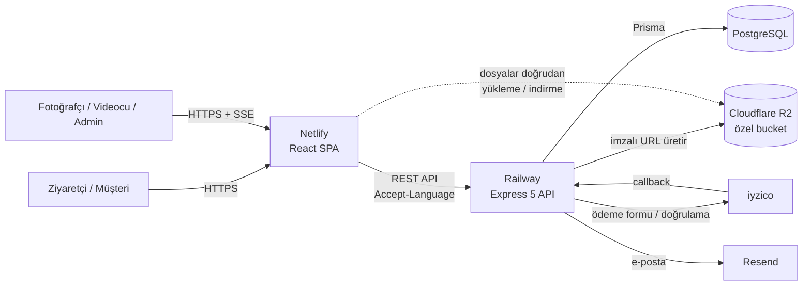

<div align="center">

# RNG Sport

**Ritmik cimnastik başta olmak üzere spor organizasyonları için fotoğraf & video rezervasyon, online ödeme, saha çekim takibi ve kişisel dijital galeri platformu.**

[rngsport.com](https://rngsport.com) · Türkçe · English · Русский


</div>

---

## Öne çıkanlar

- 🌐 **Canlıda ve gerçek kullanımda:** Yarışmalarda gerçek müşteriler ve sahadaki çekim ekibi tarafından kullanılan bir sistem — [rngsport.com](https://rngsport.com)
- 💳 **Uçtan uca satış akışı:** iyzico ile online ödeme, yarışma günü ödenen ön rezervasyon, otomatik müşteri hesabı ve sadakat indirimi
- 📱 **Gerçek zamanlı saha ekranı:** Fotoğrafçı ve videocunun telefonda kullandığı, anlık senkronize çekim listesi
- 🔒 **Özel kişisel galeri:** Her müşterinin fotoğraf ve videoları yalnızca kendisine açık, güvenli bulut depolamada
- 🌍 **Üç dil:** Türkçe, İngilizce ve Rusça — sayfalar, panelden girilen içerik ve e-postalar dahil

---

## İçindekiler

- [Öne çıkanlar](#öne-çıkanlar)
- [Proje hakkında](#proje-hakkında)
- [Özellikler](#özellikler)
  - [Ziyaretçi ve müşteri tarafı](#ziyaretçi-ve-müşteri-tarafı)
  - [Rezervasyon ve online ödeme](#rezervasyon-ve-online-ödeme)
  - [Müşteri hesabı ve kişisel galeri](#müşteri-hesabı-ve-kişisel-galeri)
  - [Sadakat sistemi](#sadakat-sistemi)
  - [Çok dillilik](#çok-dillilik)
  - [Yönetim paneli](#yönetim-paneli)
  - [Çekim listesi (saha ekranı)](#çekim-listesi-saha-ekranı)
- [Teknoloji yığını](#teknoloji-yığını)
- [Mimari](#mimari)
- [Proje yapısı](#proje-yapısı)
- [Geliştirme](#geliştirme)
- [Altyapı](#altyapı)
- [Güvenlik ve tasarım kararları](#güvenlik-ve-tasarım-kararları)
- [Çok dilli yapı nasıl kurgulandı](#çok-dilli-yapı-nasıl-kurgulandı)

---

## Proje hakkında

RNG Sport; yarışmalarda sporcuların performanslarını fotoğraf ve videoyla kaydeden bir spor medya ekibinin uçtan uca iş akışını yürütür:

1. **Veli / sporcu** siteden paket seçer; **ön rezervasyon** (yarışma günü standda nakit/kart) ya da **online ödeme** (iyzico) ile kaydını oluşturur.
2. Kayıtla birlikte otomatik olarak bir **müşteri hesabı** açılır.
3. Yarışmanın resmi **çıkış listesi** Excel olarak panele yüklenir; sistem ödenmiş/onaylanmış kayıtları sporcu adı + alet bazında listeyle **otomatik eşleştirir**.
4. Sahada **fotoğrafçı ve videocu** telefonlarından çekim listesini anlık takip eder, her çıkışın başlangıç/bitiş saatini tek dokunuşla işaretler.
5. Çekimler düzenlendikten sonra dosyalar müşterinin **kişisel, özel galerisine** yüklenir ve müşteriye e-postayla haber verilir.

Site üç dilde (Türkçe, İngilizce, Rusça) çalışır; yabancı katılımcılar kendi dillerinde rezervasyon yapar, kendi dillerinde e-posta alır.

---

## Özellikler

### Ziyaretçi ve müşteri tarafı

- **Ana sayfa:** Video arka planlı hero, geri sayımlı yaklaşan yarışma kampanyası, turnuva takvimi, paketler, ödül törenleri, özel ürünler, galeri, süreç anlatımı ve SSS.
- **Paketler:** Fotoğraf, video ve "Full Event" paketleri. Seri sayısına göre (1/2/3 seri) kademeli fiyat. Online ve nakit rezervasyon için ayrı fiyat listesi.
- **Öncelikli teslim:** Pakete göre seri başına ek ücretle 7 günde teslim seçeneği.
- **Alet seçimi:** Her paket satırında seri sayısı kadar alet seçilir (Top, Labut, İp, Kurdele, Çember, Serbest). Çekim listesi eşleşmesi buna dayanır.
- **Ödül törenleri:** Herkese açık, girişsiz tören galerileri. Tek tek veya toplu (zip) indirme.
- **Galeri, Hakkımızda, Özel Ürünler** (kişiye özel sporcu figürü, ışıklı cimnastik harfi) sayfaları.
- **Yasal metinler:** KVKK aydınlatma metni, gizlilik politikası, mesafeli satış sözleşmesi, iptal-iade koşulları. İngilizce ve Rusça çevirileri "bağlayıcı olan Türkçe metindir" notuyla sunulur.
- **WhatsApp destek butonu**, mobil uyumlu tasarım, SEO (canonical, hreflang, Open Graph, çok dilli site haritası).

### Rezervasyon ve online ödeme

- **Ön rezervasyon (nakit akışı):**
  - Misafir veya girişli kullanıcı rezervasyon yapabilir.
  - Girişli müşterinin bilgileri forma ön-dolu gelir.
  - Aynı hesaptan kardeş/ikiz sporcular için ayrı rezervasyonlar yapılabilir. Aynı sporcuya ikinci aktif rezervasyon açılamaz; isimler büyük-küçük harf ve Türkçe karakterden bağımsız karşılaştırılır.
  - Müşteri, ödeme alınana kadar rezervasyonunu profilinden düzenleyip silebilir.
- **Online ödeme (iyzico):**
  - Sepet ile çalışır.
  - Fiyatlar her zaman sunucuda veritabanından hesaplanır; istemciden gelen fiyat kullanılmaz.
  - iyzico ödeme sayfasına yönlendirilir; dönüşte ödenen tutar doğrulanır.
  - Sipariş "Ödendi" olunca çekim listesine anında yansır ve müşteriye onay e-postası gider.
  - Ödeme başarısız olursa müşteri dolu sepete geri döner.
  - iyzico formu Türkçe siparişte Türkçe, diğer dillerde İngilizce açılır. Sonuç sayfası siparişin dilinde gösterilir.
- **Otomatik hesap:** Kayıt sırasında e-postaya bağlı bir müşteri hesabı açılır. Müşteri başarı ekranında tek adımda şifresini belirleyip hesabına girebilir; atlarsa e-postadaki bağlantıyı kullanır.

### Müşteri hesabı ve kişisel galeri

- E-posta ile kayıt ve giriş, e-posta doğrulama (engelleyici değil), şifremi unuttum, şifre değiştirme.
- **Profil:**
  - Sporcu bilgileri
  - Rezervasyonlar ve siparişler
  - Sadakat puanı ve seviye ilerlemesi
  - Puan geçmişi
- **Galerim:** Müşterinin kendi fotoğraf ve videoları.
  - Yarışma/albüm ve tür (fotoğraf/video) filtreleri.
  - Fotoğraflar için lightbox, videolar için oynatıcı.
  - Dosya bazında indirme.
- **Toplu indirme (zip):** Zip dosyası **tarayıcıda** oluşturulur, dosyalar doğrudan Cloudflare R2'den çekilir, sunucu trafiği harcanmaz. Masaüstü Chrome/Edge'de diske akıtılarak her boyut desteklenir. Büyük galerilerde ve mobilde sunucu tarafı zip'e otomatik geçilir.
- **E-posta bildirimleri (Resend):**
  - rezervasyon alındı,
  - ödeme alındı,
  - "fotoğraflarınız hazır",
  - e-posta doğrulama ve şifre sıfırlama.

  Hepsi kaydın ya da isteğin dilinde gönderilir.

### Sadakat sistemi

- Her paketin seri başına puanı vardır. Puan yalnızca **ödenmiş** kayıtlarda kazanılır.
- **Seviyeler** (ör. Bronz / Gümüş / Altın) admin panelden yönetilir.
  - Bakiye bir seviyeye ulaşınca sonraki alışverişte o seviyenin indirimi **otomatik** uygulanır ve seviyenin puanı harcanır.
  - Kalan puan birikmeye devam eder.
- Tüm hareketler bir **puan defterinde** (kazanma, geri alma, harcama, iade, düzeltme) tutulur.
  - Durum değişiklikleri (ödendi → iptal gibi) puanı çift saymaz ya da kaybetmez.
  - Eşzamanlı işlemler kullanıcı başına Postgres advisory lock ile sıraya alınır.
- Admin, müşteri puanını açıklama zorunluluğuyla düzeltebilir.

### Çok dillilik

- **Türkçe, İngilizce, Rusça.** Türkçe adresler öneksiz (`/rezervasyon`); diğer diller `/en/...` ve `/ru/...` ile.
- Menüde dil seçici: dillerin kendi adlarıyla, bayraksız (Türkçe / English / Русский). Tarayıcı dili İngilizce/Rusça olan ziyaretçiye dil önerisi bandı çıkar; zorla yönlendirme yapılmaz.
- **Neler çevriliyor:**
  - sabit metinler,
  - sunucu hata mesajları,
  - e-postalar,
  - tarih ve sayı biçimleri.
- Panelden girilen içerikler (paket adları ve özellikleri, turnuvalar, ödül törenleri, seviye adları) için **ayrı çeviri alanları** var. Boş bırakılan dil Türkçeye düşer.
- **Admin paneli ve çekim listesi bilinçli olarak Türkçe** kalır.

### Yönetim paneli

- **Dashboard:** Sipariş, rezervasyon ve gelir istatistikleri.
- **Rezervasyonlar ve Siparişler:**
  - Listeleme, arama ve durum filtresi.
  - Detay, düzenleme, silme ve durum yönetimi.
  - Admin panelden rezervasyon ekleme.
  - Sayfalar **sayfa yenilemeden** kendini günceller; açık bir form varsa bekler.
- **Çekim listesi eşleşme renkleri:** Her kayıt, çekim listesiyle aynı kuralla (isim + alet) kontrol edilir.
  - yeşil: eşleşiyor,
  - turuncu: isim var ama alet uyuşmuyor,
  - kırmızı: isim listede yok, büyük olasılıkla yanlış yazılmış.

  Yanlış yazılmış bir isim ya da yanlış seçilmiş bir alet yarışmadan önce fark edilir.
- **Paketler:**
  - Fiyatlar (online/nakit, 1/2/3 seri).
  - Öncelik ücreti, sadakat puanı, sıralama, aktif/pasif.
  - R2'ye görsel yükleme.
  - EN/RU çeviriler.
- **Turnuvalar** (ana sayfa takvimi) ve **Ödül törenleri** (tören oluşturma, sürükle-bırak toplu yükleme). Her ikisi de çeviri sekmeli.
- **Kullanıcılar:**
  - Müşteri listesi ve müşteri detayı.
  - Müşteriye özel galeri yükleme (fotoğraf ≤30 MB, video ≤500 MB, tarayıcıdan doğrudan R2'ye).
  - Şifre belirleme bağlantısı gönderme, puan düzeltme.
- **Personel:** Admin, fotoğrafçı ve videocu hesapları. Son admin silinemez ve admin kendi yetkisini kaldıramaz.
- **Sadakat:** Seviye tanımları (eşik puan, indirim yüzdesi, EN/RU ad).

### Çekim listesi (saha ekranı)

Yarışma günü ekibin telefonlarda kullandığı, gecikmeye karşı optimize edilmiş canlı ekran:

- **Excel yükleme:** Resmi çıkış listesi gün gün yüklenir.
- **Otomatik eşleşme:** Her çıkış (sporcu + alet), ödenmiş sipariş ve onaylı rezervasyonlarla eşleştirilir. "Çekilecek / Çekilmeyecek" işaretleri **fotoğraf ve video izi için ayrı** hesaplanır; Full Event paketi iki izi de kapsar.
- **Rol bazlı görünüm:**
  - Fotoğrafçı yalnızca foto izini, videocu yalnızca video izini görür ve yönetir.
  - Admin Tümü / Fotoğraf / Video arasında geçiş yapar.
  - Ekipler birbirinin süresini değiştiremez.
- **Zincirleme zamanlama:**
  - Çıkışlar arasında boşluk olmadığı için "Başlat"a basmak bir önceki sporcuyu aynı saniyede kapatır.
  - Saatler saniye hassasiyetinde tutulur, hatalar düzenleme penceresinden düzeltilir.
  - Çekilecek sporcuda yeşil **ÇEKİLİYOR**, çekilmeyecek sporcuda mor **SAHNEDE** gösterilir.
- **Foto klasör numaraları:** Kameradaki klasör numarası (100, 101, ...) foto başlangıç sırasından otomatik türetilir. Tek satırda yapılan düzeltme sonrakileri kendiliğinden kaydırır.
- **Anlık senkronizasyon (SSE):** Bir ekipteki her değişiklik diğer tüm açık ekranlara anında yansır. Butonlar iyimser güncellenir; hata olursa geri alınır.
- **Admin araçları:** Excel dışa aktarma (iki iz birden, klasör ve öncelik bilgisiyle), günün sürelerini onaylı toplu sıfırlama, gün silme / yeniden yükleme.

---

## Teknoloji yığını

| Katman | Teknolojiler |
| --- | --- |
| **Ön yüz** | React 19, TypeScript, Vite 7, Tailwind CSS 4 (`@tailwindcss/vite`), React Router 7, Framer Motion, i18next + react-i18next, Axios, client-zip, lucide-react, react-toastify |
| **Sunucu** | Node.js, Express 5, Prisma 6 ORM, JSON Web Token (httpOnly çerez), bcryptjs, express-rate-limit, multer + xlsx (Excel okuma/yazma), archiver (sunucu tarafı zip) |
| **Veritabanı** | PostgreSQL |
| **Dosya depolama** | Cloudflare R2 (S3 uyumlu, **özel** bucket) — AWS SDK v3 + imzalı URL'ler |
| **Ödeme** | iyzico Checkout Form |
| **E-posta** | Resend |
| **Barındırma** | Netlify (ön yüz) · Railway (API + PostgreSQL) |

---

## Mimari



- **Dosyalar Express'ten geçmez.** Yükleme ve indirme tarayıcı ile R2 arasında, sunucunun ürettiği kısa ömürlü imzalı URL'lerle yapılır.
- **Fiyat güvenliği.** İstemci yalnızca paket kimliği, seri sayısı, adet, alet ve öncelik seçimini gönderir. Bütün tutarlar sunucuda veritabanından hesaplanır, iyzico dönüşünde ödenen tutar yeniden doğrulanır.
- **Gerçek zamanlı ekranlar.** Çekim listesi ve admin kayıt sayfaları Server-Sent Events ile beslenir. Süre yazımları yalnızca çekim listesini, sipariş/rezervasyon değişiklikleri ise her ikisini yeniler.
- **Uzak veritabanına göre optimize edilmiş okuma.** Çekim listesi istatistikleri tek sorgudan bellekte hesaplanır; eşleşmeler yalnızca bir kayıt değiştiğinde yeniden kurulur. Liste okuma ~4,4 s'den ~0,35 s'ye indi.

---

## Proje yapısı

```
rngsport/
├── backend/                     # Express 5 + Prisma API (port 3000)
│   ├── prisma/
│   │   ├── schema.prisma        # Veri modeli
│   │   └── seed.js              # Başlangıç verisi
│   └── src/
│       ├── index.js             # Uygulama girişi, CORS, ara katmanlar, rotalar
│       ├── routes/              # /api/* rota tanımları
│       ├── controllers/         # İş mantığı (sipariş, rezervasyon, ödeme, çekim listesi, galeri, ...)
│       ├── middleware/          # Kimlik doğrulama, rol kontrolü, hata yakalama
│       ├── lib/                 # Prisma, R2, iyzico, Resend e-posta şablonları, olay yolu
│       └── utils/               # Fiyatlama, sadakat defteri, i18n sözlüğü, doğrulayıcılar, roller
└── client/                      # React 19 + Vite SPA (port 5173)
    ├── public/                  # Statik görseller, videolar, sitemap.xml, _redirects
    └── src/
        ├── pages/               # Müşteri sayfaları, auth/, legal/, admin/
        ├── components/          # Ortak bileşenler ve admin/ bileşenleri
        ├── context/             # AuthContext, CartContext
        ├── hooks/               # Sadakat, zip indirme, canlı yenileme
        ├── lib/                 # API istemcisi, dil yolları, biçimlendirme, roller
        ├── locales/             # tr / en / ru metin dosyaları
        ├── data/                # Statik içerik (ürünler, galeri, yasal metin çevirileri)
        └── i18n/                # i18next kurulumu
```

---

## Geliştirme

Monorepo; iki bağımsız uygulamadan oluşur ve her biri kendi dizininden çalıştırılır:

- `backend/` — Express 5 + Prisma API (`npm run dev`, port 3000)
- `client/` — React 19 + Vite SPA (`npm run dev`, port 5173)

Ödeme, e-posta ve dosya depolama gibi dış servisler ortam değişkenleriyle bağlanır. Bir servis tanımlı değilse sunucu açılışta bunu loglar ve o özellik olmadan çalışmaya devam eder.

---

## Altyapı

| Bileşen | Platform | Rolü |
| --- | --- | --- |
| Ön yüz | **Netlify** | Statik React uygulaması. Tüm yollar (`/en/*`, `/ru/*` dahil) tek sayfa uygulamaya yönlendirilir. |
| API + veritabanı | **Railway** | Express API ve PostgreSQL. Canlı ekranları besleyen SSE akışı sunucu içi olay yoluyla çalışır. |
| Dosyalar | **Cloudflare R2** | Tamamen **özel** bucket. Müşteri fotoğraf ve videoları yalnızca kısa ömürlü imzalı bağlantılarla açılır; dosya trafiği sunucudan geçmez. |
| Ödeme | **iyzico** | Barındırılan ödeme sayfası. Dönüşte tutar ve işlem kimliği sunucuda doğrulanır. |
| E-posta | **Resend** | Doğrulanmış alan adından, alıcının dilinde işlem e-postaları. |

---

## Güvenlik ve tasarım kararları

- **Kimlik doğrulama:** JWT, 30 gün geçerli **httpOnly** çerezde tutulur. Canlıda `secure` + `sameSite=none` (ön yüz ve API ayrı alan adlarında), geliştirmede `sameSite=lax`.
- **Roller:** `admin`, `fotografci`, `videocu`, `customer`. Tek kaynak `backend/src/utils/roles.js`, istemci karşılığı `client/src/lib/roles.ts`. Personel yalnızca çekim listesine erişir.
- **Hız sınırları:** Giriş, kayıt ve şifre işlemleri IP + hesap bazında sınırlanır. Yarışma salonunda veliler aynı Wi-Fi'ı paylaştığı için salt IP bazlı sıkı bir sınır bilinçli olarak kullanılmaz.
- **Şifre ve tokenlar:** Şifreler bcrypt ile saklanır. E-posta doğrulama ve şifre sıfırlama tokenları veritabanında yalnızca **sha256 özeti** olarak tutulur (24 saat / 1 saat geçerli).
- **Galeri gizliliği:** Bucket hiçbir zaman herkese açık değildir.
  - Görüntüleme 1 saatlik, indirme 5 dakikalık imzalı URL'lerle yapılır.
  - Yükleme onayında her dosya anahtarının kullanıcının kendi klasöründe olduğu doğrulanır; başka kullanıcının klasörüne dosya eklenemez.
- **Paket görselleri:** Sepet görsel adreslerini tarayıcıda sakladığı için süresi dolmayan bir backend proxy'si üzerinden sunulur. Bu proxy kullanıcı klasörlerine erişimi engeller.
- **Ödeme:** Tutar hiçbir zaman istemciden alınmaz. iyzico dönüşünde ödenen tutar ve konuşma kimliği doğrulanır. Sadakat indirimi iyzico sepet kalemlerine oranlı dağıtılır.
- **Hata yönetimi:** E-posta gönderimi hiçbir API isteğini bozmaz; hatalar loglanır. R2 yapılandırma eksikleri ve bağlantı hataları anlaşılır kodlarla raporlanır (503 / 502).
- **Kişisel veri:** Çekim listeleri ve yedekler çocuk isimleri içerdiği için repoya eklenmez.

---

## Çok dilli yapı nasıl kurgulandı

- **Metinler:** `client/src/locales/{tr,en,ru}/*.json` alan bazında bölünmüştür (`common`, `home`, `checkout`, `auth`, `account`, `pages`). Bileşenlerde `t("alan.anahtar")` ile kullanılır.
  - Türkçe dosya asıl metindir.
  - Üç dilde anahtarlar birebir aynı olmalı.
  - İngilizce çoğullar `_one` / `_other` ekleriyle yazılır.
- **Sunucu mesajları:** Kodda Türkçe yazılır; `backend/src/utils/i18n.js` sözlüğü isteğin diline çevirir. Sözlükte olmayan mesaj Türkçe gider, hiçbir şey bozulmaz.
- **Panel içerikleri:** Paket, turnuva, tören ve seviyelerde `translations` alanı vardır; admin formlarındaki EN/RU sekmelerinden doldurulur.
- **Yasal metinler:** Türkçe asıl metin `client/src/pages/legal/` altında, çevirileri `client/src/data/legal.ts` içindedir. Türkçe metin değiştiğinde çeviri de güncellenmelidir.
- **Genişletilebilir:** Yeni bir dil, dil listesine eklenip metin dosyaları ve sunucu sözlüğü çevrilerek desteklenir; adres yapısı ve bileşenler değişmez.

---

<div align="center">

**RNG Sport** · Range Media

</div>
